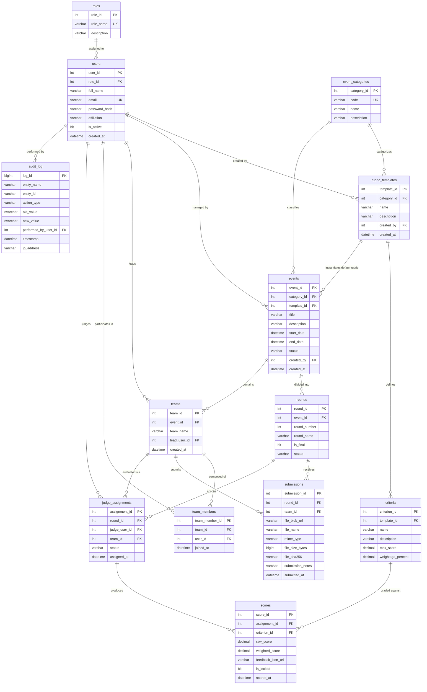

# ScoreVault: Relational Database Design (RDBMS)

**Document Version:** 1.0  
**Date:** October 19, 2026  
**Authors:** Raj Singh (25LBCS3205) & Prince (25LBCS3005)  
**Course:** Integrated Full-Stack Project (RDBMS Component - 20 Marks)  
**Database Target:** Azure SQL Database (Relational Engine)  

---

## 1. Relational Schema Overview & 13 Tables

ScoreVault uses an enterprise-grade relational database structure strictly adhering to **Third Normal Form (3NF)**. The schema comprises **13 related tables** designed to maintain referential integrity, eliminate data anomalies, and support high-throughput, audit-proof evaluation:

1. `roles` — System access tiers (`ADMIN`, `JUDGE`, `PARTICIPANT`).
2. `users` — Registered individuals with authentication credentials and institutional affiliation.
3. `event_categories` — Competition domains (`HACKATHON`, `DANCE`, `LAW`, `LITERATURE`).
4. `rubric_templates` — Reusable master evaluation rubrics.
5. `criteria` — Criterion-level grading rules with maximum marks and percentage weights.
6. `events` — High-level competition instances tied to a category and rubric template.
7. `rounds` — Sequential competition stages (e.g., Prelims, Semi-Finals, Finals).
8. `teams` — Participating squads or solo entrants registered under an event.
9. `team_members` — Normalized bridge table mapping users to teams with specific roles.
10. `submissions` — Multi-modal file artifacts uploaded to Azure Blob Storage per team per round.
11. `judge_assignments` — Conflict-validated mappings of judges to team entries per round.
12. `scores` — Criterion-by-criterion numeric marks, weighted scores, and locking status.
13. `audit_log` — Immutable ledger of all data modifications captured via database triggers.

---

## 2. Entity-Relationship (ER) Diagram



---

## 3. Normalization Justification (Third Normal Form - 3NF)

To ensure academic and architectural rigor, every relation was engineered through progressive normalization stages:

### 3.1 First Normal Form (1NF)
- **Criterion:** All attributes are atomic (no repeating groups, comma-separated lists, or arrays stored in single fields).
- **Compliance:**
  - Team members are not stored as delimited strings inside `teams`. Instead, individual members exist as separate atomic tuples in the associative entity `team_members`.
  - Criteria scores are not concatenated into a single row. Each criterion rating is an independent record in `scores`.
  - Every column has an explicitly declared domain type (`INT`, `VARCHAR`, `DECIMAL(5,2)`, `DATETIME2`).

### 3.2 Second Normal Form (2NF)
- **Criterion:** Relation must be in 1NF and all non-key attributes must be fully functionally dependent on the entire Primary Key (no partial dependencies on composite keys).
- **Compliance:**
  - Bridge entities (`team_members`, `judge_assignments`, `scores`) utilize surrogate identity keys (`team_member_id`, `assignment_id`, `score_id`) alongside candidate unique composite constraints (e.g., `UNIQUE(team_id, user_id)`).
  - Attributes such as `joined_at` depend strictly on the complete association between a user and a team, eliminating partial dependency anomalies.

### 3.3 Third Normal Form (3NF)
- **Criterion:** Relation must be in 2NF and contain zero transitive functional dependencies ($X \to Y$ where $Y$ is not a candidate key and $X$ is not a superkey).
- **Compliance:**
  - **User Roles:** `role_name` and permissions are normalized into `roles` table. `users` holds only `role_id`. If role descriptions change, zero updates are needed in the `users` table.
  - **Event Categories:** Category definitions (`code`, `name`, `description`) are isolated in `event_categories`. `events` holds only `category_id`.
  - **Rubric Criteria:** Criteria definitions (`max_score`, `weightage_percent`) depend solely on `template_id` in `criteria`. `scores` stores only the evaluated `raw_score` and references `criterion_id`.
  - **Conflict-of-Interest Integrity:** Affiliation is anchored to the individual in `users` (`affiliation`). Teams do not have an independent hardcoded affiliation; the application dynamically derives it from `team_members -> users.affiliation`, preventing update anomalies when team composition shifts.

---

## 4. Key Constraints, Integrity Rules & Indexes

### 4.1 Check Constraints
1. **Rubric Criteria Weight Bounds:**
   ```sql
   ALTER TABLE criteria ADD CONSTRAINT chk_criteria_weight 
   CHECK (weightage_percent > 0 AND weightage_percent <= 100);
   ```
2. **Valid Raw Score Range:**
   ```sql
   ALTER TABLE scores ADD CONSTRAINT chk_raw_score_non_negative 
   CHECK (raw_score >= 0);
   ```
3. **Event Category Codes:**
   ```sql
   ALTER TABLE event_categories ADD CONSTRAINT chk_category_code 
   CHECK (code IN ('HACKATHON', 'DANCE', 'LAW', 'LITERATURE'));
   ```

### 4.2 Unique Constraints
- `users(email)` — Guarantees unique login identifier per user.
- `team_members(team_id, user_id)` — Prevents duplicate membership of the same user in a team.
- `judge_assignments(round_id, judge_user_id, team_id)` — Prevents redundant assignment of the same judge to a team entry in the same round.
- `scores(assignment_id, criterion_id)` — Enforces exactly one score entry per criterion per judge assignment.

### 4.3 High-Performance Indexing Strategy
To guarantee sub-$50\text{ ms}$ latency on searched and joined columns:
```sql
CREATE NONCLUSTERED INDEX idx_users_email ON users(email);
CREATE NONCLUSTERED INDEX idx_users_affiliation ON users(affiliation);
CREATE NONCLUSTERED INDEX idx_teams_event ON teams(event_id);
CREATE NONCLUSTERED INDEX idx_team_members_lookup ON team_members(team_id, user_id);
CREATE NONCLUSTERED INDEX idx_submissions_round_team ON submissions(round_id, team_id);
CREATE NONCLUSTERED INDEX idx_assignments_round_judge ON judge_assignments(round_id, judge_user_id);
CREATE NONCLUSTERED INDEX idx_scores_assignment ON scores(assignment_id);
CREATE NONCLUSTERED INDEX idx_audit_entity ON audit_log(entity_name, entity_id);
```

---

## 5. RDBMS Specialized Components (View, Procedure, Trigger, Transaction)

### 5.1 Relational View: `vw_round_leaderboard`
Aggregates normalized criterion scores, applies criterion percentage weights, handles multi-judge averages, and ranks teams per round:
- **Joins involved:** 5 tables (`rounds`, `events`, `teams`, `judge_assignments`, `scores`, `criteria`).
- **Functionality:** Provides immediate read-optimized ranking with zero calculation needed on client.

### 5.2 Database Trigger: `trg_audit_score_changes`
Enforces tamper-resistance:
- **Event:** `AFTER UPDATE, DELETE ON scores`
- **Action:** If an update occurs on a row where `is_locked = 1`, the trigger validates that an authorized admin override flag is active. It immediately persists the previous score, new score, modifying session, and timestamp into `audit_log`.

### 5.3 Stored Procedure & ACID Transaction: `sp_finalize_and_lock_round_scores`
- **Purpose:** Atomically finalizes an evaluation round.
- **Transaction Properties:**
  - `SET TRANSACTION ISOLATION LEVEL SERIALIZABLE;`
  - Validates that all assigned judges have submitted their scores.
  - Locks all score rows (`is_locked = 1`).
  - Updates `rounds.status = 'COMPLETED'`.
  - Records finalization milestone into `audit_log`.
  - If any failure occurs, executes `ROLLBACK TRANSACTION` to maintain 100% data consistency.
