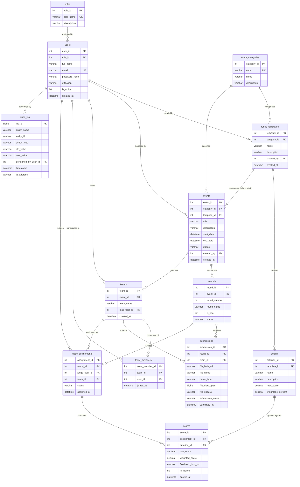

# ScoreVault: Relational Database Design (RDBMS)

**Document Version:** 1.1 (revised to match the deployed database)  
**Date:** October 19, 2026 (revised after integrity controls were added)  
**Authors:** Raj Singh (25LBCS3205) & Prince (25LBCS3005)  
**Course:** Integrated Full-Stack Project (RDBMS Component - 20 Marks)  
**Database Target:** Azure SQL Database (Relational Engine)  

---

## 1. Relational Schema Overview & 13 Tables

ScoreVault uses an enterprise-grade relational database structure strictly adhering to **Third Normal Form (3NF)**. The schema comprises **13 related tables** designed to maintain referential integrity, eliminate data anomalies, and support high-throughput, audit-proof evaluation:

1. `roles` — System access tiers (`ADMIN`, `JUDGE`, `PARTICIPANT`).
2. `users` — Registered individuals with authentication credentials and institutional affiliation.
3. `event_categories` — Competition domains (`HACKATHON`, `DANCE`, `LAW`, `LITERATURE`).
4. `rubric_templates` — Reusable master evaluation rubrics.
5. `criteria` — Criterion-level grading rules with maximum marks and percentage weights.
6. `events` — High-level competition instances tied to a category and rubric template.
7. `rounds` — Sequential competition stages (e.g., Prelims, Semi-Finals, Finals).
8. `teams` — Participating squads or solo entrants registered under an event.
9. `team_members` — Normalized bridge table resolving the many-to-many relationship between users and teams.
10. `submissions` — Multi-modal file artifacts uploaded to Azure Blob Storage per team per round.
11. `judge_assignments` — Mappings of judges to team entries per round, validated by the database trigger `trg_judge_conflict`.
12. `scores` — Criterion-by-criterion numeric marks, weighted scores (0 to 100 scale), and locking status.
13. `audit_log` — Append-only ledger of score changes and round finalisations, protected by the trigger `trg_audit_log_immutable`.

---

## 2. Entity-Relationship (ER) Diagram



---

## 3. Normalization Justification (Third Normal Form - 3NF)

To ensure academic and architectural rigor, every relation was engineered through progressive normalization stages:

### 3.1 First Normal Form (1NF)
- **Criterion:** All attributes are atomic (no repeating groups, comma-separated lists, or arrays stored in single fields).
- **Compliance:**
  - Team members are not stored as delimited strings inside `teams`. Instead, individual members exist as separate atomic tuples in the associative entity `team_members`.
  - Criteria scores are not concatenated into a single row. Each criterion rating is an independent record in `scores`.
  - Every column has an explicitly declared domain type (`INT`, `VARCHAR`, `DECIMAL(5,2)`, `DATETIME2`).

### 3.2 Second Normal Form (2NF)
- **Criterion:** Relation must be in 1NF and all non-key attributes must be fully functionally dependent on the entire Primary Key (no partial dependencies on composite keys).
- **Compliance:**
  - Bridge entities (`team_members`, `judge_assignments`, `scores`) utilize surrogate identity keys (`team_member_id`, `assignment_id`, `score_id`) alongside candidate unique composite constraints (e.g., `UNIQUE(team_id, user_id)`).
  - Attributes such as `joined_at` depend strictly on the complete association between a user and a team, eliminating partial dependency anomalies.

### 3.3 Third Normal Form (3NF)
- **Criterion:** Relation must be in 2NF and contain zero transitive functional dependencies ($X \to Y$ where $Y$ is not a candidate key and $X$ is not a superkey).
- **Compliance:**
  - **User Roles:** `role_name` and permissions are normalized into `roles` table. `users` holds only `role_id`. If role descriptions change, zero updates are needed in the `users` table.
  - **Event Categories:** Category definitions (`code`, `name`, `description`) are isolated in `event_categories`. `events` holds only `category_id`.
  - **Rubric Criteria:** Criteria definitions (`max_score`, `weightage_percent`) depend solely on `template_id` in `criteria`. `scores` stores only the evaluated `raw_score` and references `criterion_id`.
  - **Conflict-of-Interest Integrity:** Affiliation is anchored to the individual in `users` (`affiliation`). Teams do not have an independent hardcoded affiliation; the database trigger `trg_judge_conflict` (and the application) derive it from the team lead and `team_members -> users.affiliation`, preventing update anomalies when team composition shifts.
  - **Controlled redundancy (`scores.weighted_score`):** `weighted_score` is a derived value (`raw_score / max_score * weightage_percent`), so strictly it can be recomputed from other tables. It is kept deliberately so that leaderboards and audits need no recalculation. To avoid the update anomaly that redundancy normally causes, the trigger `trg_scores_validate` rejects any row whose `weighted_score` disagrees with its `raw_score` (see Section 5.4).

---

## 4. Key Constraints, Integrity Rules & Indexes

### 4.1 Check Constraints
1. **Rubric Criteria Weight Bounds:**
   ```sql
   ALTER TABLE criteria ADD CONSTRAINT chk_criteria_weightage 
   CHECK (weightage_percent > 0 AND weightage_percent <= 100);
   ```
2. **Valid Raw Score Range:**
   ```sql
   ALTER TABLE scores ADD CONSTRAINT chk_raw_score_positive 
   CHECK (raw_score >= 0);
   ```
3. **Event Category Codes:**
   ```sql
   ALTER TABLE event_categories ADD CONSTRAINT chk_category_code 
   CHECK (code IN ('HACKATHON', 'DANCE', 'LAW', 'LITERATURE'));
   ```

Rules that compare several tables, such as "a score cannot exceed the criterion's `max_score`" or "a judge cannot belong to the team's institution", cannot be written as a single-row `CHECK`. They are enforced by triggers (Section 5.2).

### 4.2 Unique Constraints
- `users(email)` — Guarantees unique login identifier per user.
- `team_members(team_id, user_id)` — Prevents duplicate membership of the same user in a team.
- `judge_assignments(round_id, judge_user_id, team_id)` — Prevents redundant assignment of the same judge to a team entry in the same round.
- `scores(assignment_id, criterion_id)` — Enforces exactly one score entry per criterion per judge assignment.

### 4.3 High-Performance Indexing Strategy
To guarantee sub-$50\text{ ms}$ latency on searched and joined columns:
```sql
CREATE NONCLUSTERED INDEX idx_users_email ON users(email);
CREATE NONCLUSTERED INDEX idx_users_affiliation ON users(affiliation);
CREATE NONCLUSTERED INDEX idx_teams_event ON teams(event_id);
CREATE NONCLUSTERED INDEX idx_team_members_lookup ON team_members(team_id, user_id);
CREATE NONCLUSTERED INDEX idx_submissions_round ON submissions(round_id, team_id);
CREATE NONCLUSTERED INDEX idx_assignments_judge ON judge_assignments(round_id, judge_user_id);
CREATE NONCLUSTERED INDEX idx_scores_assignment ON scores(assignment_id);
CREATE NONCLUSTERED INDEX idx_audit_entity ON audit_log(entity_name, entity_id);
```

---

## 5. RDBMS Specialized Components (View, Triggers, Procedures, Transaction)

### 5.1 Relational Views
**`vw_round_leaderboard`** aggregates normalized criterion scores, handles multi-judge averages, and ranks teams per round:
- **Tables joined (6):** `rounds`, `events`, `teams`, `users` (team lead), `judge_assignments`, `scores`.
- **What counts:** only scores with `is_locked = 1` on assignments with status `SUBMITTED`.
- **Calculation:** `final_weighted_average_score = SUM(weighted_score) / COUNT(DISTINCT judge)`, on a 0 to 100 scale.
- **Ranking:** `DENSE_RANK() OVER (PARTITION BY round_id ORDER BY final_weighted_average_score DESC)`.

**`vw_judge_scoring_variance`** computes each judge's average raw score and standard deviation per event category. It feeds the Power BI report on judge strictness and leniency.

### 5.2 Database Triggers (6)
The database enforces the rules itself, so they hold even if the application has a bug or someone connects directly. Each rejecting trigger rolls back the transaction and raises a numbered error, which the Spring layer maps to an HTTP status.

| Trigger | Table | Fires on | Rule enforced | Error |
| :--- | :--- | :--- | :--- | :--- |
| `trg_audit_score_changes` | `scores` | AFTER UPDATE, DELETE | Writes the old and new values (JSON) to `audit_log` with the acting user id and client IP from the session context (Section 6) | none |
| `trg_scores_locked_guard` | `scores` | AFTER UPDATE, DELETE | Rejects any change or delete of a locked score, unless the session flag `admin_override` = 1 | 50030 |
| `trg_scores_validate` | `scores` | AFTER INSERT, UPDATE | `raw_score` <= `max_score`; the criterion belongs to the event's rubric; `weighted_score` = `raw_score / max_score * weightage_percent` (tolerance 0.01) | 50031, 50032, 50033 |
| `trg_judge_conflict` | `judge_assignments` | AFTER INSERT, UPDATE | The judge is an active user with the `JUDGE` role; the team belongs to the round's event; the judge is not the lead or a member; the judge's affiliation differs from the lead's and every member's (case-insensitive, trimmed) | 50040, 50041, 50042, 50043 |
| `trg_submissions_check` | `submissions` | AFTER INSERT, UPDATE | The team and the round belong to the same event; no new submissions once a round is `COMPLETED` | 50050, 50051 |
| `trg_audit_log_immutable` | `audit_log` | INSTEAD OF UPDATE, DELETE | Blocks modification or deletion of audit rows, so the log is append-only | 50060 |

Suggested HTTP mapping in Spring: 50030 to `423 Locked`; 50031 to 50033 to `422 Unprocessable`; 50040 to 50043 and 50050 to 50051 to `409 Conflict`.

### 5.3 Stored Procedure & ACID Transaction: `sp_finalize_and_lock_round_scores`
- **Purpose:** Atomically finalizes an evaluation round.
- **Transaction properties:**
  - `SET TRANSACTION ISOLATION LEVEL SERIALIZABLE;`
  - Validates that all assigned judges have submitted their scores.
  - Locks all score rows (`is_locked = 1`). Each lock is an update, so `trg_audit_score_changes` records it in `audit_log`.
  - Updates `rounds.status = 'COMPLETED'`.
  - Records the finalization milestone, with the administrator's user id, in `audit_log`.
  - If any failure occurs, executes `ROLLBACK TRANSACTION` so no partial result remains.

### 5.4 Weighted Score Scale
`weighted_score = raw_score / max_score * weightage_percent`. A rubric's weights are percentages that total 100, so one judge's total for a team is out of 100. Seed example: 28.5 + 27.0 + 21.25 + 13.5 = 90.25 out of 100. The rule that a rubric's weights total 100 spans several rows, so it is validated in the application when a rubric is created (the API returns 422 if the sum is not 100).

---

## 6. Session Context Contract (Audit Attribution)

The backend connects with one shared database login, so a trigger cannot tell which person acted. Before it changes data, the backend sets the acting user in the connection's session context:

```sql
EXEC sp_set_session_context @key = N'user_id',   @value = 42;           -- logged-in user
EXEC sp_set_session_context @key = N'client_ip', @value = '203.0.113.7';
-- only for a deliberate, logged administrator unlock of a locked score:
EXEC sp_set_session_context @key = N'admin_override', @value = 1;
```

Connections are pooled and reused, so values persist after a request ends. The backend must set or clear all three keys on every request. Without them the audit rows fall back to a NULL user and the IP text `SYSTEM_DB_TRIGGER`.

---

## 7. Verification

The scripts run in this order on an empty Azure SQL Database (free serverless tier): `schema.sql`, `integrity_triggers.sql`, `seed_data.sql`, `integrity_tests.sql`. Installing the triggers before the seed means the seed data is validated too.

`integrity_tests.sql` contains 13 tests. Each runs in a transaction that is rolled back and prints PASS or FAIL. All 13 passed on the deployed database.

| Test | What it checks | Expected error |
| :--- | :--- | :--- |
| T1 | A participant cannot be assigned as a judge | 50040 |
| T2 | A team from another event cannot be assigned to a round | 50041 |
| T3 | A judge who is a team member is rejected | 50042 |
| T4 | A judge with the same affiliation as the team is rejected | 50043 |
| T5 | A locked score cannot be edited | 50030 |
| T6 | A locked score cannot be deleted | 50030 |
| T7 | A score above the criterion maximum is rejected | 50031 |
| T8 | A criterion from another event's rubric is rejected | 50032 |
| T9 | A `weighted_score` that does not match `raw_score` is rejected | 50033 |
| T10 | A submission whose team and round are in different events is rejected | 50050 |
| T11 | `audit_log` cannot be updated | 50060 |
| T12 | `audit_log` cannot be deleted | 50060 |
| T13 | An admin override is allowed and the audit row records the user and IP | pass |

---

## 8. Design Notes & Known Limitations
- **Affiliation is free text.** It is compared case-insensitively after trimming, so a spelling variant (for example "BITS-Pilani" and "BITS Pilani") would not match. A managed list of institutions is a future improvement.
- **Audit attribution depends on the backend** setting the session context (Section 6).
- **Updates and deletes of scores are audited by trigger;** the first insert of a score is not. Locking and round finalization are always logged.
- **`schema.sql` begins with `DROP` statements** that delete all data. Run it only on a new or test database.
