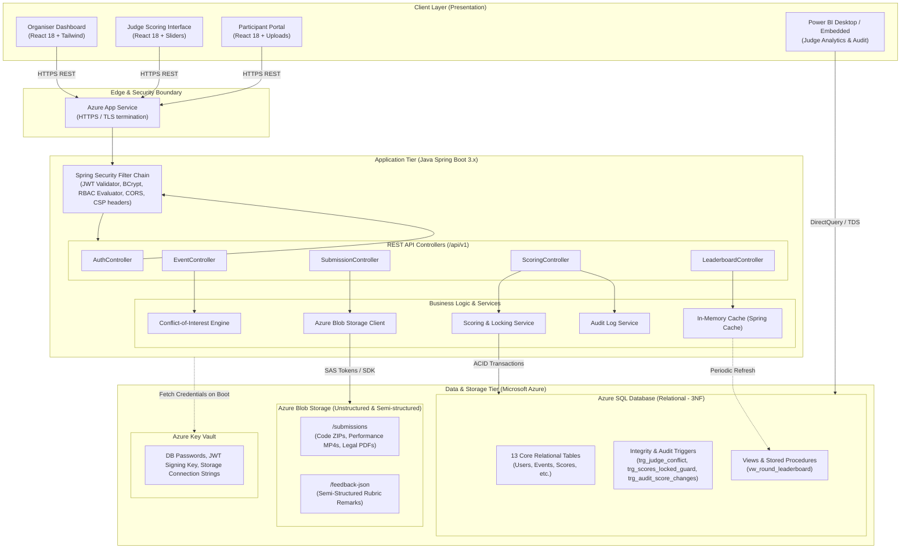
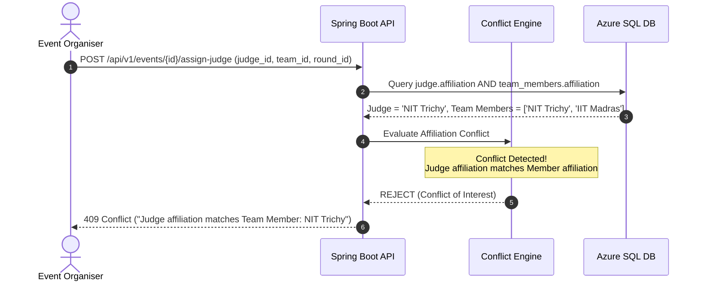
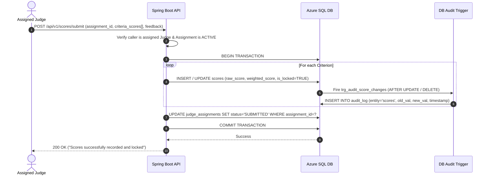

# ScoreVault: System Design Document

**Document Version:** 1.2 (revised to match the deployed database)  
**Date:** October 19, 2026 (revised October 22, 2026)  
**Authors:** Raj Singh (25LBCS3205) & Prince (25LBCS3005)  
**Course:** Integrated Full-Stack Project (System Design Component - 20 Marks)  

---

## 1. Executive Summary & Problem Context

ScoreVault is a high-integrity, cloud-hosted evaluation and auditing portal designed for multi-category inter-college competitions (hackathons, dance competitions, moot court/law contests, and literature symposia). 

Traditional event evaluation relies on paper score-sheets or unversioned spreadsheets, leading to mathematical inaccuracies, subjective inconsistency, retrospective tampering, conflicts of interest, and zero auditability. ScoreVault resolves these vulnerabilities by pairing role-based access control (RBAC) with dynamic weighted rubrics, automated conflict-of-interest detection, immutable database-level audit triggers, and Azure Blob-backed multi-modal submission processing.

---

## 2. Requirements Specification

### 2.1 Functional Requirements (FR)

#### FR-1: User Management & Authentication (Cloud Security & System Design)
- **FR-1.1:** System shall support three primary roles: `ADMIN` (Organiser), `JUDGE`, and `PARTICIPANT`.
- **FR-1.2:** Authentication shall use JSON Web Tokens (JWT) with HMAC-SHA256 signatures, passing user ID, role, and college affiliation in claims.
- **FR-1.3:** Passwords must be hashed using `bcrypt` (work factor 12) prior to persistence.
- **FR-1.4:** Password reset and profile updates must trigger security audit logs.

#### FR-2: Event, Category & Rubric Template Configuration
- **FR-2.1:** Organisers can configure events under predefined categories (`HACKATHON`, `DANCE`, `LAW`, `LITERATURE`).
- **FR-2.2:** Each event supports multiple rounds (e.g., Preliminary, Semi-Final, Final).
- **FR-2.3:** Rubrics must be customizable with multiple criteria, each with an assigned max score and percentage weightage.
- **FR-2.4:** System must validate that the sum of criterion weightages for any rubric equals exactly $100\%$.

#### FR-3: Team Registration & Submission Engine
- **FR-3.1:** Participants can create a team or register solo. The creator is designated `Team Lead`.
- **FR-3.2:** Team leads can invite or add members up to the event's team-size ceiling.
- **FR-3.3:** Teams can upload multi-modal submissions based on category:
  - Hackathons: `.zip` source archive + GitHub URL.
  - Dance: `.mp4` performance recording + music attribution sheet.
  - Law / Moot Court: `.pdf` legal memorials & arguments.
  - Literature: `.pdf` / `.docx` essay or poetry manuscripts.
- **FR-3.4:** Submissions are written directly to Azure Blob Storage; the relational database stores only the immutable Blob URI, metadata, MIME type, and cryptographic hash.

#### FR-4: Conflict-of-Interest Aware Judge Assignment Engine
- **FR-4.1:** Organisers can assign judges to rounds/teams manually or via automated round-robin.
- **FR-4.2:** **Automated Conflict-of-Interest Blocking:** The assignment engine validates that:
  $$\text{judge}.\text{affiliation} \neq \text{team\_member}.\text{affiliation} \quad \forall \, \text{members in target team}$$
  Any attempted assignment violating this condition must be rejected with HTTP 409 Conflict. The database enforces the same rule independently through the trigger `trg_judge_conflict`, which also rejects users who are not judges, teams from another event, and judges who are members of the team. Affiliations are compared case-insensitively after trimming.

#### FR-5: Scoring, Evaluation & Tamper-Resistant Locking
- **FR-5.1:** Judges can only view and score submissions explicitly assigned to them.
- **FR-5.2:** Judges evaluate each criterion independently. Weighted score (0 to 100 scale, stored in `scores.weighted_score`) is computed server-side and re-validated by the database trigger `trg_scores_validate`:
  $$\text{Final Weighted Score} = \sum_{i=1}^{n} \left(\frac{\text{raw\_score}_i}{\text{max\_score}_i} \times \text{weightage}_i\right)$$
- **FR-5.3:** Judges can provide qualitative textual feedback, stored as semi-structured JSON.
- **FR-5.4:** **Score Locking:** Upon final submission by a judge, the score state transitions to `LOCKED = TRUE`. Any subsequent update or delete attempt without administrative override is rejected by both application logic (HTTP 423) and the database trigger `trg_scores_locked_guard`. An override requires the session flag `admin_override` (Section 4.4) and is recorded in `audit_log`.
- **FR-5.5:** An administrative unlock requires explicit cryptographic logging with reason.

#### FR-6: Live Leaderboard, Tie-Breaking & Analytics
- **FR-6.1:** Leaderboards compute aggregated scores across judges per round.
- **FR-6.2:** In case of tie, secondary criterion priority rules break the tie (e.g., Code Quality in Hackathons, Legal Reasoning in Moot Court).
- **FR-6.3:** Leaderboard visibility is toggled by the Admin (Draft, Internal Review, Publicly Published).
- **FR-6.4:** Power BI embeds and endpoints expose analytics on judge severity/leniency variance.

---

### 2.2 Non-Functional Requirements (NFR)

| ID | Category | Specification |
| :--- | :--- | :--- |
| **NFR-1** | **Security & Privacy** | OWASP Top 10 compliance: zero plain-text secrets, strict parameterized SQL queries, XSS sanitization, CSP headers, HTTPS-only traffic (TLS 1.2 or higher, enforced as the minimum version on App Service). |
| **NFR-2** | **Data Integrity** | Strict ACID transactional semantics for score persistence and locking; zero phantom updates; append-only audit log (`trg_audit_log_immutable`) with score changes captured by `trg_audit_score_changes`. |
| **NFR-3** | **Availability** | Available during scheduled event and demo windows. The database uses the Azure SQL free serverless tier, which auto-pauses when idle, so the first request after a pause can take a short time to resume; the database is warmed up before demos. No formal uptime guarantee is claimed on free tiers. |
| **NFR-4** | **Performance & Latency** | Design targets, to be checked with a simple load test: P95 latency for scoring submissions $< 200\text{ ms}$; P95 latency for reading the public leaderboard $< 50\text{ ms}$ under cached operation. |
| **NFR-5** | **Scalability** | Design target: concurrent evaluation by 100 judges and about 500 spectators checking the leaderboard on result day, achieved by caching the leaderboard rather than adding servers. Measured limits are reported in the final report. |
| **NFR-6** | **Maintainability** | Clean modular architecture separating Controller, Service, and Data Access (Repository) layers in Java Spring Boot. |

---

## 3. High-Level System Architecture

ScoreVault follows a hardened **Three-Tier Architecture** deployed natively on Microsoft Azure:



---

## 4. End-to-End Data Flow & Sequence Workflows

### 4.1 Workflow 1: Participant Submission Flow

```mermaid
sequenceDiagram
    autonumber
    actor Participant as Team Lead (Participant)
    participant Client as React Web App
    participant API as Spring Boot API
    participant Blob as Azure Blob Storage
    participant SQL as Azure SQL DB

    Participant->>Client: Select Event Round & Upload File (ZIP / MP4 / PDF)
    Client->>API: POST /api/v1/submissions (multipart/form-data + JWT)
    API->>API: Validate JWT Role (PARTICIPANT) & File MIME/Size limits
    API->>Blob: Stream file buffer to container `submissions/{roundId}/{teamId}`
    Blob-->>API: Return Blob Storage URI & ETag
    API->>SQL: INSERT INTO submissions (team_id, round_id, blob_url, file_hash, submitted_at)
    SQL-->>API: 1 row inserted (submission_id)
    API->>SQL: INSERT INTO audit_log (SUBMISSION_UPLOADED, team_id)
    API-->>Client: 201 Created (submission_id, blob_url)
    Client-->>Participant: Display submission confirmation with timestamp
```

---

### 4.2 Workflow 2: Conflict-Free Judge Assignment Flow



---

### 4.3 Workflow 3: Scoring, Finalization & Immutable Locking



---

### 4.4 Database Session Context (Audit Attribution)
The backend uses one shared database login, so the database cannot tell which person acted. On every request, before changing data, the backend calls:

```sql
EXEC sp_set_session_context @key = N'user_id',   @value = <logged-in user id>;
EXEC sp_set_session_context @key = N'client_ip', @value = '<caller IP>';
EXEC sp_set_session_context @key = N'admin_override', @value = 1;   -- only for a logged administrator unlock
```

The audit trigger reads these values and writes them to `audit_log`. Connections are pooled and reused, so the backend sets or clears all three keys on every request. If it does not, audit rows show a NULL user.

## 5. API Specification Catalog (`/api/v1`)

All endpoints require `Authorization: Bearer <JWT_TOKEN>` unless designated `Public`.

### 5.1 Authentication & Profile (`/api/v1/auth`)

| Method | Endpoint | Allowed Roles | Description | Request Body | Response Codes |
| :--- | :--- | :--- | :--- | :--- | :--- |
| `POST` | `/api/v1/auth/register` | Public | Register new user account | `{ fullName, email, password, affiliation, roleName }` | `201 Created`, `400 Bad Request` |
| `POST` | `/api/v1/auth/login` | Public | Authenticate user & issue JWT | `{ email, password }` | `200 OK (token, userObj)`, `401 Unauthorized` |
| `GET` | `/api/v1/auth/me` | All | Fetch active session & permissions | None | `200 OK`, `401 Unauthorized` |

### 5.2 Event & Rubric Management (`/api/v1/events`)

| Method | Endpoint | Allowed Roles | Description | Request Body | Response Codes |
| :--- | :--- | :--- | :--- | :--- | :--- |
| `POST` | `/api/v1/events` | `ADMIN` | Create event with round & category | `{ categoryId, templateId, title, desc, startDate, endDate }` | `201 Created`, `403 Forbidden` |
| `GET` | `/api/v1/events` | Public | List all active competitions | Query parameters: `?category=HACKATHON` | `200 OK` |
| `GET` | `/api/v1/events/{id}` | Public | Detailed event view with rounds | None | `200 OK`, `404 Not Found` |
| `POST` | `/api/v1/rubrics` | `ADMIN` | Define reusable weighted rubric | `{ categoryId, name, criteria: [{ name, maxScore, weightage }] }` | `201 Created`, `422 Unprocessable (sum!=100%)` |

### 5.3 Teams & Submissions (`/api/v1/teams`, `/api/v1/submissions`)

| Method | Endpoint | Allowed Roles | Description | Request Body | Response Codes |
| :--- | :--- | :--- | :--- | :--- | :--- |
| `POST` | `/api/v1/teams` | `PARTICIPANT` | Register new team | `{ eventId, teamName, memberUserIds: [...] }` | `201 Created`, `400 Bad Request` |
| `POST` | `/api/v1/submissions` | `PARTICIPANT` | Upload file to Azure Blob & record submission | `multipart/form-data: { roundId, teamId, file, notes }` | `201 Created`, `415 Unsupported Media`, `413 Too Large` |
| `GET` | `/api/v1/submissions/{id}` | `ADMIN`, `JUDGE` | Get submission metadata & secure read SAS URL | None | `200 OK`, `403 Forbidden` |

### 5.4 Judge Assignment & Scoring (`/api/v1/judging`, `/api/v1/scores`)

| Method | Endpoint | Allowed Roles | Description | Request Body | Response Codes |
| :--- | :--- | :--- | :--- | :--- | :--- |
| `POST` | `/api/v1/judging/assign` | `ADMIN` | Assign judge with conflict validation | `{ roundId, judgeUserId, teamId }` | `201 Created`, `409 Conflict (COI detected)` |
| `GET` | `/api/v1/judging/my-assignments` | `JUDGE` | List entries assigned to requesting judge | None | `200 OK` |
| `POST` | `/api/v1/scores` | `JUDGE` | Submit and lock rubric scores | `{ assignmentId, items: [{ criterionId, score }], feedbackJson }` | `200 OK`, `400 Invalid Score`, `423 Locked` |
| `POST` | `/api/v1/scores/{id}/override` | `ADMIN` | Administrative score unlock with audit | `{ reason, newScore }` | `200 OK`, `403 Forbidden` |

### 5.5 Leaderboard & Analytics (`/api/v1/leaderboard`)

| Method | Endpoint | Allowed Roles | Description | Request Body | Response Codes |
| :--- | :--- | :--- | :--- | :--- | :--- |
| `GET` | `/api/v1/leaderboard/{roundId}` | Public | Get ranked standings with tie-break metrics | None | `200 OK` |
| `GET` | `/api/v1/analytics/judge-variance` | `ADMIN` | Fetch statistical scoring variance across judges | None | `200 OK` |

---

## 6. Architecture Trade-Off Analysis

### 6.1 Trade-Off 1: Monolithic Architecture vs. Microservices Architecture

- **Context:** The team comprises 2 engineers with a 20-day delivery timeline. The domain involves transactional event scoring, where cross-entity referential integrity between `users`, `teams`, `submissions`, `criteria`, and `scores` is paramount.
- **Decision:** Adopt a **Modular Monolith** in Java Spring Boot rather than a distributed Microservices architecture.
- **Rationale & Analysis:**
  1. *Transactional Consistency:* Score submission, conflict validation, and audit logging require atomic transactions across multiple tables (`scores`, `judge_assignments`, `audit_log`). A monolith handles this via standard database ACID transactions (`@Transactional`). In microservices, this would necessitate the 2-Phase Commit (2PC) or Saga pattern with compensating transactions, adding immense complexity and risk of eventual consistency glitches during live rounds.
  2. *Operational Overhead:* A microservices setup requires service discovery, distributed tracing, API gateways, independent CI/CD pipelines, and multi-service cloud container management (e.g., Azure Kubernetes Service). This would consume excessive infrastructure budget and engineering hours.
  3. *Latency:* In-process calls between Spring components execute in sub-millisecond timeframes, avoiding network hop serialization penalties inherent in inter-service gRPC or REST calls.

### 6.2 Trade-Off 2: Leaderboard Read Caching vs. Real-Time DB Aggregation

- **Context:** On the day competition results are published, read traffic spikes sharply as hundreds of participants and spectators refresh rankings simultaneously. Calculating the leaderboard requires multi-table joins across `teams`, `scores`, `criteria`, and `rounds`.
- **Decision:** Implement **Read-Heavy Invalidation Caching** for the leaderboard.
- **Rationale & Analysis:**
  1. *Database Load Protection:* Running `SUM(raw_score * weightage)` and `RANK() OVER (ORDER BY score DESC)` queries directly against Azure SQL Database on every single HTTP GET would use up the database's limited compute (vCore seconds on the free serverless tier) and could slow judge scoring.
  2. *Cache Strategy:* The leaderboard view is cached in memory (Spring `@Cacheable`). The cache is invalidated automatically upon an event trigger: when a judge locks a score or when an administrator finalizes a round (`@CacheEvict`).
  3. *Trade-Off:* The system trades a short delay while the cache is rebuilt after a lock or finalisation for far fewer database reads. The expected benefit (a large drop in database reads and fast leaderboard responses) is a design target, to be measured with a simple load test for the final report.
