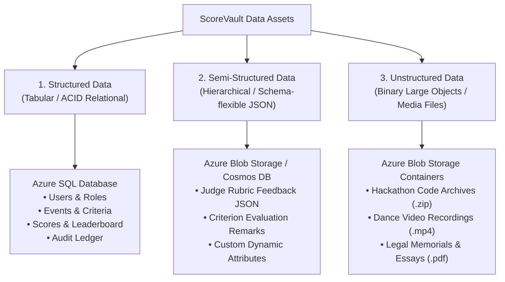
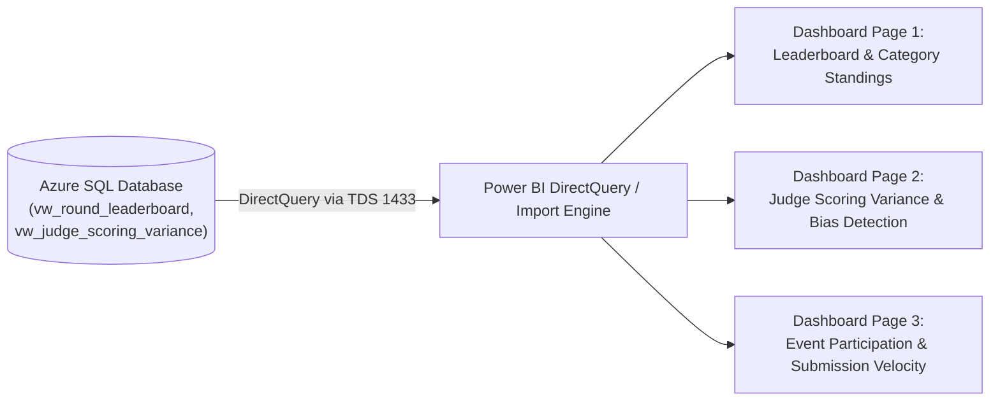

# ScoreVault: DP-900 Data Architecture & Classification Report

**Document Version:** 1.0  
**Date:** October 19, 2026  
**Authors:** Raj Singh (25LBCS3205) & Prince (25LBCS3005)  
**Course:** Integrated Full-Stack Project (DP-900 Azure Data Fundamentals Component - 20 Marks)  

---

## 1. Data Classification Model

In compliance with the **DP-900: Microsoft Azure Data Fundamentals** syllabus, ScoreVault categorizes all application data into three distinct architectural classes based on schema definition, storage characteristics, and query patterns:

### 1.1 Detailed Classification Matrix

| Data Category | Classification | Format / Schema | Storage Service | Volume & Access Pattern |
| :--- | :--- | :--- | :--- | :--- |
| **Authentication & RBAC** | **Structured** | Fixed schema tables (`users`, `roles`) | Azure SQL Database | High read frequency, low write frequency. Parameterized ACID lookups. |
| **Event & Rubric Config** | **Structured** | Fixed schema tables (`events`, `criteria`, `rounds`) | Azure SQL Database | Read-heavy during active competition days. Relational joins for rubric weights. |
| **Scoring Records & Locking** | **Structured** | Fixed decimal fields (`scores`, `judge_assignments`) | Azure SQL Database | High-integrity transactional writes (`is_locked = 1`). Immediate consistency. |
| **Audit Logs** | **Structured** | Relational records with embedded JSON diffs (`audit_log`) | Azure SQL Database | Append-only sequential inserts via triggers. |
| **Judge Qualitative Feedback** | **Semi-Structured**| Dynamic JSON key-value documents | Azure Blob Storage (`/feedback-json`) | Created at score time. Semi-structured allowing flexible comments per criterion. |
| **Participant Submissions** | **Unstructured**| Binary files (`.zip`, `.mp4`, `.pdf`) | Azure Blob Storage (`/submissions`) | Write-once during submission window; streaming reads during judging. |

---

## 2. Azure Data Storage Architecture & Implementation

### 2.1 Relational Store: Azure SQL Database
- **Role:** Central transactional repository for all 13 core relational tables.
- **Service Tier:** General Purpose / Serverless (vCore model for academic cost optimization).
- **Security & Network Rules:**
  - Public network access set to `Disabled` or restricted via Azure SQL Firewall rules.
  - Allowed IP rules configured strictly for Azure App Service outbound virtual IP.
  - Transparent Data Encryption (TDE) enabled by default at rest.

### 2.2 Non-Relational Store: Azure Blob Storage
- **Role:** Scalable object repository for multi-modal competition artifacts.
- **Container Structure:**
  - `scorevault-submissions/` (Private access tier):
    - Path format: `{category}/{round_id}/{team_id}/{file_name}`
    - Access mechanism: Shared Access Signature (SAS) tokens generated on demand by the Spring Boot backend with a 15-minute expiration window.
  - `scorevault-feedback/` (Private access tier):
    - Path format: `feedback-json/{round_id}/{assignment_id}.json`
    - Stores semi-structured judge feedback payloads without cluttering relational table rows.

---

## 3. Microsoft Power BI Analytics Architecture

To fulfill the DP-900 analytical reporting requirement, Power BI connects to Azure SQL Database using the dedicated analytics views (`vw_round_leaderboard` and `vw_judge_scoring_variance`).

### 3.1 Key Analytical Reports & Visualizations

#### Report Page 1: Live Event Leaderboard & Category Performance
- **Visuals:** Stacked Bar Chart of top 10 teams by final weighted score; Card visual for top-ranking team; Filter slicers for Category (`HACKATHON`, `DANCE`, `LAW`, `LITERATURE`) and Round.
- **Data Source:** `vw_round_leaderboard`.

#### Report Page 2: Judge Scoring Patterns & Outlier Detection (Bias Audit)
- **Visuals:** Scatter plot displaying Judge Average Raw Score vs. Standard Deviation.
- **Objective:** Detect unusually lenient judges (high average, low spread) or harsh outlier judges (low average, high standard deviation) across academic categories.
- **Data Source:** `vw_judge_scoring_variance`.

#### Report Page 3: Submission & Evaluation Throughput
- **Visuals:** Line chart tracking submission timestamps vs. evaluation completion rate; Donut chart representing file formats uploaded (`.zip` vs `.pdf` vs `.mp4`).
- **Data Source:** `submissions` and `judge_assignments`.
