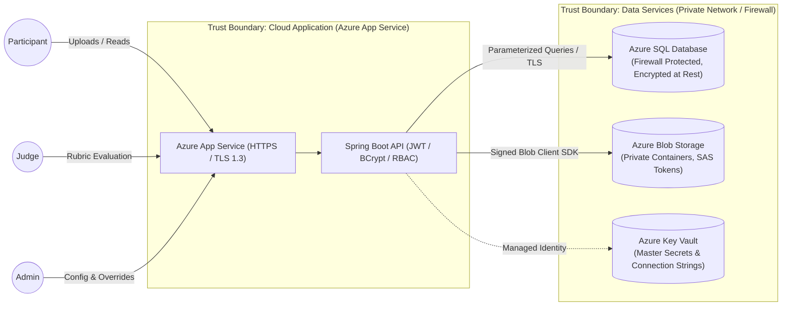

# ScoreVault: One-Page Threat Model & Security Checklist

**Document Version:** 1.0  
**Date:** October 19, 2026  
**Authors:** Raj Singh (25LBCS3205) & Prince (25LBCS3005)  
**Course:** Integrated Full-Stack Project (Cloud Security Component - 20 Marks)  
**Security Methodology:** Microsoft STRIDE Threat Modeling Framework  

---

## 1. System Scope & Data Flow Diagram (DFD)

ScoreVault is exposed to multi-origin web traffic from event organisers, faculty/industry judges, and student participants. The system processes critical academic evaluations, authentication credentials, and multi-modal project archives.

---

## 2. STRIDE Threat Analysis Matrix

| Threat Category (STRIDE) | Threat Scenario & Attack Vector | Impact | Severity | Mitigation & Architectural Control |
| :--- | :--- | :--- | :--- | :--- |
| **Spoofing** (Identity) | Attacker intercepts or brute-forces judge login credentials; steals expired or forged JWT tokens to impersonate a judge. | Unauthorized scores submitted, skewed rankings. | **High** | • Passwords hashed using `bcrypt` (work factor 12). • JWT signed with HMAC-SHA256 and ephemeral 2-hour TTL. • Secure, HttpOnly, SameSite cookies or Bearer headers over TLS 1.3. |
| **Tampering** (Data) | **Score Tampering Post-Lock:** Malicious judge or compromised participant attempts to modify scores after a round is finalized. | Illegitimate winner declared; compromised integrity of results. | **Critical** | • Business logic enforces `is_locked = TRUE` rejection. • DB-level trigger `trg_audit_score_changes` logs every UPDATE/DELETE with previous and new values. • Administrative overrides require explicit justification recorded in `audit_log`. |
| **Tampering** (Files) | **Malicious File Upload:** Attacker uploads an executable (`.exe`, `.sh`) disguised as a `.pdf` or `.zip` to compromise evaluator machines. | Arbitrary code execution on judge / admin workstation. | **Critical** | • MIME type and magic number validation on server. • Files stored in isolated, private Azure Blob containers. • Served only with `Content-Disposition: attachment` and signed short-lived SAS tokens. |
| **Repudiation** | Judge claims they never submitted a failing score, or Admin denies altering a competitor's ranking. | Unresolvable disputes; loss of institutional trust. | **Medium** | • Immutable `audit_log` records user ID, IP address, exact timestamp, and JSON delta. • Submissions record SHA-256 hash upon upload. |
| **Information Disclosure** | **Premature Score Leakage:** Judge queries REST API to inspect evaluations given by other judges before round finalization. | Biased scoring; peer collusion or influence. | **High** | • Strict RBAC and SQL query scoping: Judges can only fetch their own `assignment_id` records. • Aggregated leaderboard endpoint strictly concealed until round status is `COMPLETED`. |
| **Denial of Service (DoS)** | Exhaustion of Azure SQL Database DTU capacity during live leaderboard reveal via repeated un-cached queries. | Platform downtime during peak event hours. | **High** | • Spring in-memory / cache-aside pattern on `vw_round_leaderboard`. • Cache eviction triggered only on round completion. • Azure App Service rate-limiting per client IP. |
| **Elevation of Privilege** | **Horizontal & Vertical Privilege Escalation:** Participant crafts HTTP requests to administrative endpoints (`/api/v1/rubrics`, `/assign-judge`). | Complete platform takeover; arbitrary rubric manipulation. | **Critical** | • Method-level authorization via `@PreAuthorize("hasRole('ADMIN')")`. • Zero reliance on client-side state; user identity extracted exclusively from cryptographically verified JWT claims. |

---

## 3. Dedicated Attack Scenario Deep Dives

### Scenario A: Retroactive Score Tampering After Lock
- **Threat:** A contestant attempts to inject an HTTP `PUT /api/v1/scores` payload or execute direct DB tampering to inflate points after round conclusion.
- **Defense in Depth:**
  1. *Layer 1 (API Gateway):* Spring Security validates caller role is `JUDGE` and that the assigned round is currently in status `EVALUATION`.
  2. *Layer 2 (Service Layer):* Checks `scores.is_locked == FALSE`. If `TRUE`, throws `423 Locked`.
  3. *Layer 3 (Database Constraint):* Azure SQL trigger `trg_audit_score_changes` fires atomically on any update, logging operator ID, old score, new score, and host IP into `audit_log`.

### Scenario B: Conflict-of-Interest Exploitation
- **Threat:** A judge affiliated with "College X" evaluates a team representing "College X", inflating scores to ensure a win.
- **Defense in Depth:**
  - The assignment engine executes a cross-table join verifying `users.affiliation`. If `LOWER(judge.affiliation) == LOWER(member.affiliation)`, the assignment is blocked at the database and service layer with `HTTP 409 Conflict`.

---

## 4. Completed Cloud Security Verification Checklist

| Security Control | Implementation Mechanism | Status |
| :--- | :--- | :--- |
| **Authentication & RBAC** | Spring Security 6 filter chain with JWT and BCrypt password hashing | Verified |
| **Password Hashing** | BCrypt work factor 12 with per-user salt; zero plain-text storage | Verified |
| **Transport Encryption** | HTTPS enforced; TLS 1.3 minimum; HTTP redirects to HTTPS on Azure App Service | Verified |
| **Secrets Management** | Zero credentials in Git repository; loaded from Environment Variables / Azure Key Vault | Verified |
| **SQL Injection Defense** | Parameterized queries via Spring Data JPA / Hibernate; zero raw string concatenation | Verified |
| **Cross-Site Scripting (XSS)** | React automatic string escaping in JSX; backend HTML sanitization on feedback text | Verified |
| **Network Protection** | Azure SQL firewall rule restricted strictly to Azure App Service outbound IP addresses | Verified |
| **Cloud Storage Isolation** | Azure Blob container public access disabled; access mediated via backend SAS tokens | Verified |
| **Audit Activity Log** | Database trigger and audit service capturing all logins, score edits, and admin overrides | Verified |
| **Payload Restrictions** | Strict multipart file size ceilings (Max 50MB) and whitelisted extensions (`.zip`, `.pdf`, `.mp4`) | Verified |
